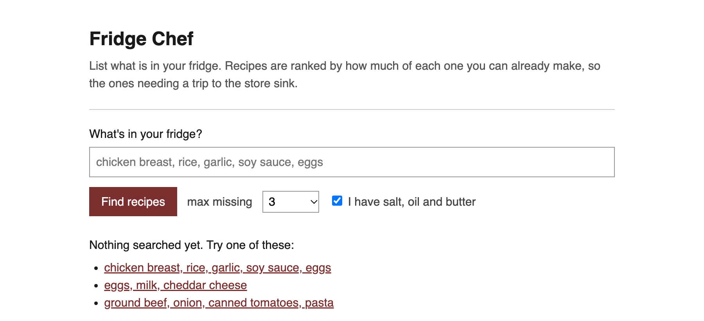
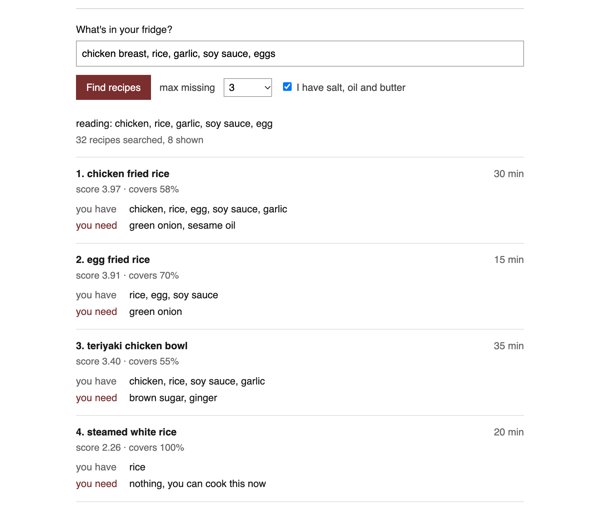
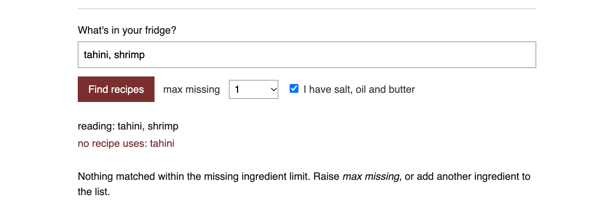

# Fridge Chef: User Interface

CSCE 470 Project Checkpoint 3 — Ayad Masud, Aryan Vemuri, Taro Omori

## The screen

Fridge Chef answers one question: what can I cook tonight without going to the store?
Checkpoints 1 and 2 built the retrieval side of that answer — ingredients normalized to a
shared vocabulary, recipes indexed by ingredient, BM25 over the overlap with the user's
list, and a penalty for every ingredient a recipe still needs. None of it was reachable
except through a command line flag.

The interface had to put that ranking in front of someone who does not know any of the
above and does not need to. We built one screen: no account, no navigation, no second
page. A user types what is in their fridge, presses one button, and reads the ranked
list underneath. Figure 1 is the page on arrival.

{ width=62% }

The empty state carries three example fridges as links. Nobody wants to invent a test
query for a search engine they have never used, and clicking a link puts a full result
page on screen in one action.

## Reading a result

Figure 2 shows the top of a search for *chicken breast, rice, garlic, soy sauce, eggs*.
Three things happen between the button and the list. The `reading:` line echoes what the
system understood: the typed `chicken breast` and `eggs` come back as `chicken` and `egg`.
The count line says how much of the collection was searched and how much is on screen.
Then the results, each split into what the user has and what they would still have to buy.

{ width=58% }

We gave `you need` the same weight as `you have`, in the same column, in a color that
draws the eye. That list is the actual decision. Someone comparing chicken fried rice
against egg fried rice is not weighing BM25 scores; they are deciding whether they feel
like going out for green onion and sesame oil. It is also the quantity the ranker
penalizes, so the row that explains the ordering is the row the user cares about anyway.

Score and coverage sit under each name in small grey type. Most users will skip them, but
when two recipes land next to each other the numbers keep the ordering from looking
arbitrary. Coverage is the more legible of the two: steamed white rice at 100% is the only
entry in Figure 2 that needs nothing.

`max missing` hides recipes needing more than a set number of extras, and the checkbox
decides whether salt, oil and butter are assumed to be in the kitchen. Both default to the
common case, so most users never touch either.

## Why one text box

Clicking through a taxonomy of ingredients is slower than typing a fridge, and the
normalizer already absorbs the phrasing variation that would otherwise justify a picker:
`Garlic Cloves`, `garlic clove` and `fresh minced garlic` all reach the index as `garlic`.

Echoing the parsed terms follows from that. Normalization is the most useful thing the
system does and also the most likely to make it look broken. If someone types `salmon
fillet` and sees results for salmon without being told why, the obvious reading is that
the search ignored half of what they wrote.

## When nothing comes back

Figure 3 is a search for *tahini, shrimp* with `max missing` set to 1. Two things go wrong
and the page reports them separately. `tahini` appears in no recipe in the collection, so
it is named rather than silently dropped: the word was read, and the data is the
limitation. Nothing then survived the missing-ingredient filter, so the page
names the control that caused it and suggests loosening it. Neither message is an error
page; the form stays filled in directly above, so the fix is one edit away.

{ width=62% }

## Implementation

The prototype is a Flask application of about sixty lines in `fridgechef/web.py`, with one
Jinja template and one stylesheet. It has a single route, which reads the query string,
calls `parse_query` and `search` — the same two functions the command line demo calls —
and hands the results to the template. Those result objects already carry the used list,
the missing list, coverage and cook time, so no ranking logic lives in the view.

There is no JavaScript. The form is a plain `GET`, so the whole state of a search lives in
the URL: the back button steps through previous fridges, a search can be bookmarked or
pasted to a teammate, and the example links are nothing more than pre-filled URLs. The
index is built once at startup rather than per request.

## Next

The vocabulary is already in memory, so the box should autocomplete against it and flag an
unknown ingredient before the user submits rather than after. After that: substitutions on
the `you need` list, and the full Food.com collection in place of the 32-recipe sample.
